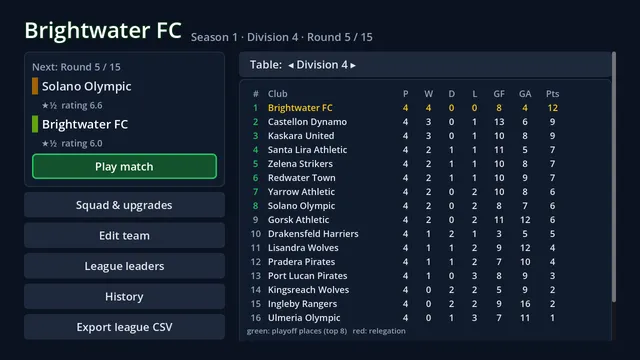
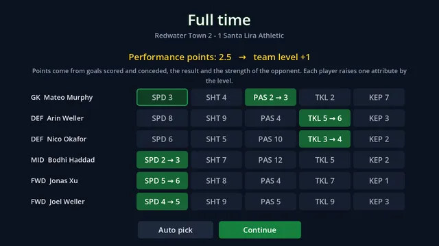

<p align="center"></p>
<h1 align="center">OpenPitchbox</h1>
<p align="center">Indoor six-a-side football with a multi-season career. A free, open-source game built on the design of SFG Soccer (2009).</p>
<p align="center"><b>English</b> · <a href="README.ru.md">Русский</a></p>

<p align="center"></p>

## Where it comes from

In 2009 Stir Fry Games, a small indie studio, released **SFG Soccer** on Xbox Live Indie Games. It was a small game with a simple idea. Six players a side play in a walled indoor arena. The ball bounces off the boards, so there are no throw-ins or corners. There are four buttons and a career mode: you take a hopeless club from the bottom division and play your way up to the cup. A PC version followed in 2010 as *Football Fever*. People who played it still look for it.

That is not easy any more. The Xbox Live Indie Games marketplace closed, and the game cannot be bought on any current store. The PC build only exists as old unsigned installers on file-download sites. Running one of those means running an executable of unknown origin on your own computer.

OpenPitchbox is the answer to that. The game is rebuilt from scratch from the design described in reviews and gameplay videos. It contains no code, art, sound or text from the original. Everything is open: you can read the source, build it yourself, or take a build that GitHub Actions made from a tagged commit. Each build comes with published checksums. The project is not affiliated with Stir Fry Games.

> [!NOTE]
> **Status: playable alpha.** The match engine, the career and the menus are complete and covered by headless tests. Keyboard, gamepad and mouse play on Linux has been tested. The Android build has been tested on a Redmi Note 9 (Mali-G52): touch controls and the phone-as-controller mode work, and the match runs at about 35 fps with the phone graphics profile. The first match on a new phone takes about 30 seconds to start while the graphics are prepared; later matches start in a few seconds. Tilt steering has not been tried on a real phone yet. Animations come from free motion capture; the keeper dive, slide tackle and bicycle kick are procedural poses on top of it. The game is in English only.

<p align="center">
 <br>
 
</p>

## What it does

**The match**
- Six a side on a 48 × 29 m indoor pitch with boards and sloping goal nets. There are no throw-ins or corners.
- Four action buttons: pass, shoot (hold for power) or slide tackle, lob, and volley / header / bicycle kick. Press before the ball arrives to play it first time.
- Players differ: pace, shooting, passing, tackling and goalkeeping each come from 1 to 20. A quick winger really outruns a slow centre-back.
- Teams keep a shape. One player presses the ball, one covers behind him, and the rest hold their zones and pick up runners. There are four difficulty levels.
- Keepers read shots with an error that depends on their rating. When a keeper is beaten, it is because he guessed wrong, never because the ball passed through him.
- Fouls for tackles from behind, free kicks, penalties, yellow and red cards. Fouls can be switched off for the classic no-rules game.
- Goal replays, four cameras, golden goal in knockout matches.

**Career**
- 64 clubs in four divisions. A season has 15 rounds and the top 8 go to the playoffs. The two finalists of each playoff go up and the bottom two go down. The top division's playoff is the Pitchbox Cup.
- After each match your team earns upgrade points from goals, the result and the opponent's strength. Each player spends them on one attribute; you choose, or let the game choose.
- Season and career statistics, league leaders, club history, three save slots.

**Your way of playing**
- Up to four people on one screen, on the same team or against each other, in exhibition matches and in career co-op.
- Gamepads, two players on one keyboard, or the mouse: the player runs towards the cursor and the buttons kick.
- On touch screens: a floating stick and four buttons in reach of the right thumb. You can steer by tilting the phone instead, and change button size and opacity.
- A phone on the same Wi-Fi can be a controller for the game on a computer or TV box.
- Gamepads with motion sensors (DualSense, Switch Pro) can steer by tilting.
- Team editor with a 3D preview. The whole league exports to two CSV files, so you can edit it in a spreadsheet and play a career in your own league.

## Controls

| | Gamepad | Keyboard 1 | Keyboard 2 | Mouse |
|---|---|---|---|---|
| Move | left stick / d-pad | W A S D | arrows | point |
| Pass | A | J | , | left click |
| Shoot, hold for power / slide | B | K or Space | . | right click |
| Lob | Y | L | / | wheel click |
| Volley, header, bicycle kick | X | I | ; | Shift |
| Switch player | LB / RB, touchpad | Q | ' | Tab |
| Pause · camera | Start · Back | Esc · C | | Esc |

## Installation

GitHub Actions builds every tagged version from that tag and attaches the files to [Releases](https://github.com/iampopovich/OpenPitchbox/releases), together with `SHA256SUMS.txt`. The build log of each release is public. No release has been tagged yet; until the first one, run the game from source or download the `OpenPitchbox-builds` artifact of the latest [CI run](https://github.com/iampopovich/OpenPitchbox/actions).

| Build | For |
|---|---|
| `OpenPitchbox-linux-x86_64.tar.gz` | 64-bit Linux: unpack and run `OpenPitchbox.x86_64` |
| `OpenPitchbox-windows-x86_64.zip` | Windows 10/11: unpack and run `OpenPitchbox.exe` (the build is not code-signed) |
| `OpenPitchbox-android-arm64.apk` | Android 7+ phones and tablets (64-bit ARM): install the APK, allowing installs from your browser or file manager. Every release is signed with the same key, so a new APK installs over the old one and keeps your careers |

You need a GPU with Vulkan; any integrated GPU from the last eight years or so will do. The game is the same on every platform: the same match, career, editor and saves. Only the default graphics profile differs: phones start on "Low" (no real-time shadows, fewer spectators, lower 3D resolution), and you can switch it under Options → Graphics. You can also run the game from source with [Godot 4.7](https://godotengine.org/download): `godot --path .`

---

## For developers

The game uses Godot 4.7 and is written only in GDScript, with no plugins or native code.

```sh
godot --path .                                               # run
godot --headless --script res://tests/run_tests.gd           # all tests (~30 s)
godot --headless --script res://tests/run_tests.gd -- career  # filter by name
godot --headless --script res://tools/probe_match.gd         # goals, saves and spacing over many AI matches
OP_AUTOPLAY=1 OP_HUMAN=1 OP_INPUT_BOT=45 godot --path .      # scripted keyboard player for 45 s
OP_TOUCH=1 OP_AUTOPLAY=1 OP_HUMAN=1 OP_DEVICE=touch godot --path .   # touch controls on a desktop
OP_SCREEN=hub OP_SCREENSHOT=/tmp/hub.png OP_SCREENSHOT_FRAME=30 godot --path .   # screenshot any screen
```

Five rules keep the code together:

1. **The match is pure logic.** `src/core` knows nothing about nodes or rendering. It runs a fixed 60 Hz step with a seeded RNG, so the same setup and inputs always produce the same match. The whole match is tested headless; the 3D view only reads the match state and its list of events.
2. **The career is data.** `src/career` holds plain objects that save to JSON. Matches the player does not play are simulated from team ratings.
3. **Every tuning number lives in `src/core/consts.gd`**, and every AI decision lives in `src/core/team_ai.gd` or the keeper code in `match_sim.gd`.
4. **Input is device-agnostic.** Keyboards, gamepads, touch, the mouse and remote phones all turn into the same `InputFrame` in `src/game/input_router.gd`, so the match never knows what you hold in your hands.
5. **Assets must be redistributable.** The code is MIT. Third-party art is CC0 or under a licence that allows redistribution, listed below with its source.

Where things are:
- `src/core`: the match engine and AI.
- `src/career`: the career, team generation and the CSV league files.
- `src/game`: the 3D view, characters, cameras, HUD, input devices and sound.
- `src/ui`: the menus.
- `tests`: the headless tests.
- `tools`: debug probes, the sound generator and the Blender scripts that cut animation clips.

To add a rule to the match:
1. Implement it in `src/core` and add a test to `tests/test_match.gd`.
2. If the view needs to react, emit an event from `MatchSim`.
3. Handle that event in `MatchView._handle_events`.

Every gameplay bug found in play-testing gets a regression test first: phantom goals beside the post, balls through the keeper, lobs nobody could control.

### Third-party assets

| What | Source | Licence |
|---|---|---|
| Character model, hair, base animations | [Quaternius](https://quaternius.com): Universal Base Characters, Universal Animation Library 1 and 2 | CC0 1.0 |
| Motion capture: kicks, catches, throws, get-ups, celebrations | [CMU Graphics Lab Motion Capture Database](http://mocap.cs.cmu.edu), retargeted by [codepawl/cmu-mocap-glb](https://huggingface.co/datasets/codepawl/cmu-mocap-glb) | CMU terms: free to use and redistribute in products; the data itself may not be sold |
| Sound effects | generated by `tools/gen_sfx.py` | MIT, like the code |

The data used in this project was obtained from mocap.cs.cmu.edu. The database was created with funding from NSF EIA-0196217.

### How it is made

OpenPitchbox is written by [Alex Popov](https://github.com/iampopovich), with Claude (Anthropic) as the coding agent. Alex sets the design, plays every build and reports what feels wrong; the agent implements, tests and documents. Issues and pull requests are welcome.

## Licence

The code is under the MIT licence; see [LICENSE](LICENSE). Third-party assets keep the licences listed above.
