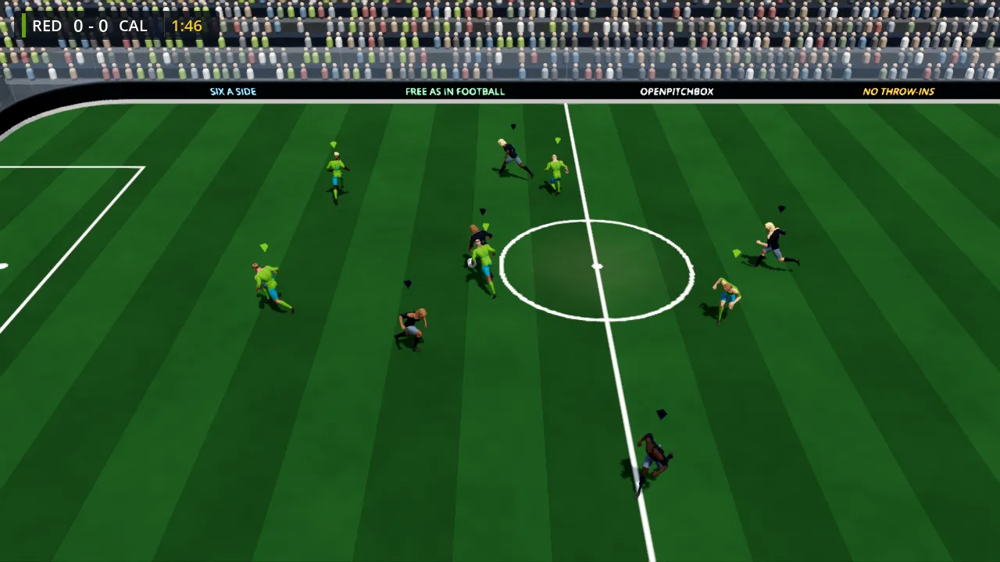
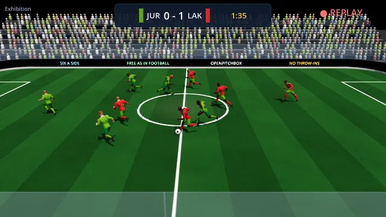
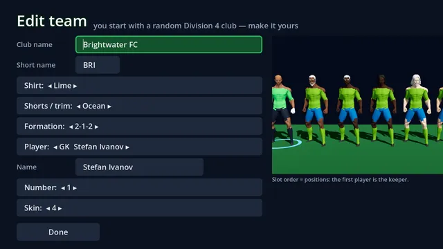

<p align="center"></p>
<h1 align="center">OpenPitchbox</h1>
<p align="center">Open-source indoor six-a-side football with a multi-season career — a free, safe-to-run take on the old SFG Soccer formula.</p>

SFG Soccer (Stir Fry Games, 2009) was a small Xbox Live Indie game that many people still look for: fast six-a-side matches in a walled arena, simple four-button controls, and a career where you drag a hopeless Division 4 club up to the cup final. The Xbox Indie marketplace is gone and the PC version only survives as unsigned installers on download sites. OpenPitchbox rebuilds that game design from public descriptions, in the open, with no original code or assets — you build it from source or take a CI-built binary with published checksums.

<p align="center">
 <br>
 
</p>

> **Status:** playable alpha. The match engine, career and menus are complete and covered by tests; animations come from free motion capture and still have rough edges (the keeper dive, slide tackle and bicycle kick are procedural poses on top of motion capture). Gamepad and keyboard play has been exercised by scripted input, not by a large group of players yet. English UI only.

## What it does

**The match**
- Six a side in an indoor arena: the ball bounces off the boards, no throw-ins or corners, goals set into the end walls with real sloping nets.
- Pass, shoot (hold for power), lob, volley / header / bicycle kick, slide tackle. Press a button before the ball arrives for a first-time pass or shot.
- Fouls for tackles from behind or through the man: free kicks, penalties in the box, yellow and red cards. Can be switched off for the classic no-rules game.
- Teams play a shape: the block slides with the ball, one player presses, one covers, the rest hold zones and pick up runners. Four difficulty levels.
- Instant replays after goals, four camera styles, golden goal in knockout matches.

**Career**
- 64 clubs in four divisions of 16. A season is 15 rounds, the top 8 go to playoffs, the two finalists go up, the bottom two go down. The Division 1 playoff is the Pitchbox Cup.
- After every match your team earns a level from goals, the result and the opponent's strength; each player puts it into one of five attributes (speed, shooting, passing, tackling, keeping), by hand or automatically.
- Season and career statistics, league leaders, history, three save slots.

**Your way**
- Up to four local players: two keyboards and up to four gamepads, on the same team or against each other, in exhibitions and in career co-op.
- Team editor with a 3D preview: club name, kit colours, formation, player names, numbers, looks and positions.
- The whole league exports to `teams.csv` and `players.csv`; edit them in any spreadsheet and play a career in your own league.

## Controls

| | Gamepad | Keyboard 1 | Keyboard 2 |
|---|---|---|---|
| Move | left stick / d-pad | W A S D | arrows |
| Pass | A | J | , |
| Shoot (hold = power) / slide without the ball | B | K or Space | . |
| Lob | Y | L | / |
| Volley, header, bicycle kick | X | I | ; |
| Switch player | LB / RB | Q | ' |
| Pause / camera | Start / Back | Esc / C | |

## Installation

Builds for every tagged version are produced by GitHub Actions from that tag and attached to the [releases](https://github.com/iampopovich/OpenPitchbox/releases) with a `SHA256SUMS.txt`.

| Build | For |
|---|---|
| `OpenPitchbox-linux-x86_64.tar.gz` | 64-bit Linux, unpack and run `OpenPitchbox.x86_64` |
| `OpenPitchbox-windows-x86_64.zip` | 64-bit Windows 10/11, unpack and run `OpenPitchbox.exe` (unsigned) |

A GPU with Vulkan support is required (any integrated GPU from the last ~8 years).

---

## For developers

Godot 4.7, GDScript only.

```sh
godot --path .                                              # run
godot --headless --script res://tests/run_tests.gd          # all tests (~40 s)
godot --headless --script res://tests/run_tests.gd -- career # filter by name
godot --headless --script res://tools/probe_match.gd        # match statistics over many AI games
OP_AUTOPLAY=1 OP_HUMAN=1 OP_INPUT_BOT=45 godot --path .     # scripted keyboard player for 45 s
OP_SCREEN=hub OP_SCREENSHOT=/tmp/hub.png OP_SCREENSHOT_FRAME=30 godot --path .  # screenshot any screen
```

Rules that keep the code together:

1. **The match is pure logic.** `src/core` knows nothing about nodes or rendering: fixed 60 Hz step, seeded RNG, the same setup and inputs always give the same match. Everything it does is tested headlessly; the 3D view only reads its state and its event list.
2. **The career is data.** `src/career` is plain objects that serialise to JSON; matches the user does not play are simulated from team ratings.
3. **Every tuning number lives in `src/core/consts.gd`**, every AI decision in `src/core/team_ai.gd`.
4. **Assets must be redistributable.** Code is MIT; third-party art is CC0 or has a licence that allows redistribution, listed below with its source.

Layout: `src/core` match engine and AI · `src/career` career, team generation, CSV league files · `src/game` 3D view, characters, camera, HUD, input, sound · `src/ui` menus · `tests` headless tests · `tools` debug probes, sound generator, Blender scripts for animation clips.

Adding a feature: put the rule in `src/core` with a test in `tests/test_match.gd`, emit an event from `MatchSim` if the view needs to react, then handle it in `MatchView._handle_events`.

### Third-party assets

| What | Source | Licence |
|---|---|---|
| Character model, hair, base animations | [Quaternius](https://quaternius.com) Universal Base Characters, Universal Animation Library 1 and 2 | CC0 1.0 |
| Motion capture (kicks, runs, catches, falls) | [CMU Graphics Lab Motion Capture Database](http://mocap.cs.cmu.edu), retargeted by [codepawl/cmu-mocap-glb](https://huggingface.co/datasets/codepawl/cmu-mocap-glb) | CMU terms: free to use and redistribute in products, the data itself may not be sold |
| Sound effects | generated by `tools/gen_sfx.py` | MIT, as the code |

The data used in this project was obtained from mocap.cs.cmu.edu. The database was created with funding from NSF EIA-0196217.

OpenPitchbox is not affiliated with Stir Fry Games; it only reimplements the game design described in public reviews and videos.

## Licence

MIT, see [LICENSE](LICENSE).
