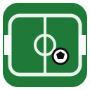
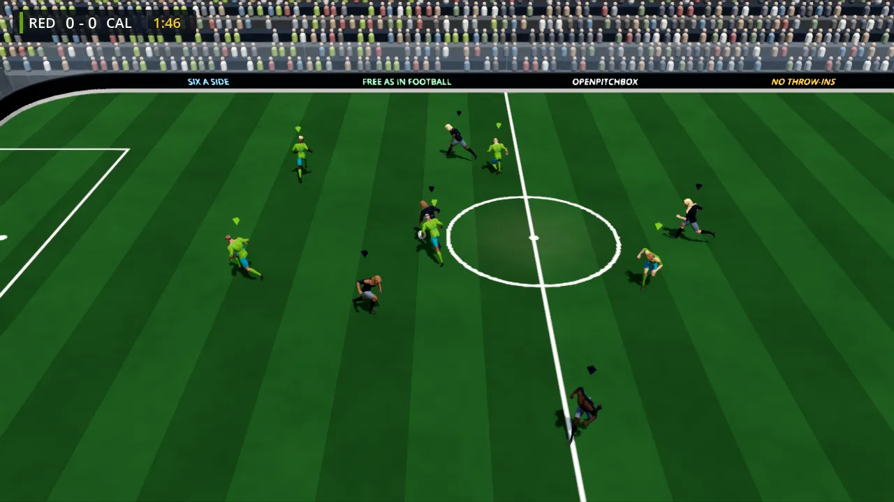
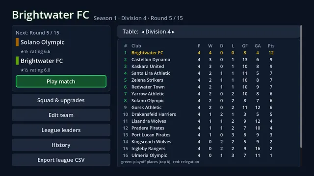
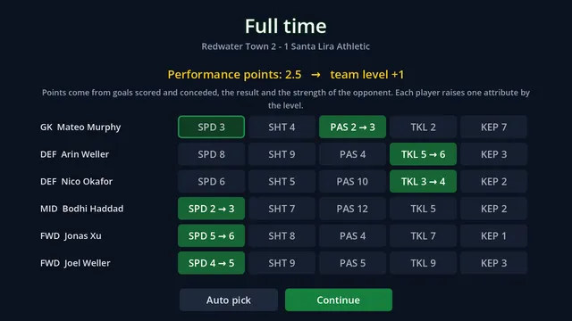
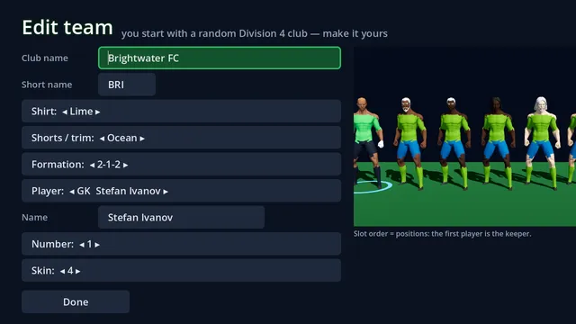
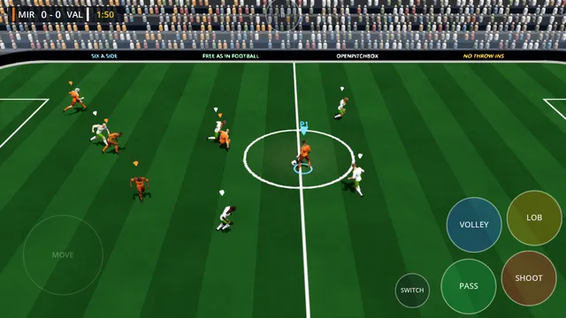

<h1 align="center">OpenPitchbox</h1>

Футбол шесть на шесть в закрытом зале, с многосезонной карьерой. Бесплатная игра с открытым кодом, сделанная по мотивам SFG Soccer (2009).

<a href="README.md">English</a> · <b>Русский</b>

## Откуда проект

В 2009 году небольшая инди-студия Stir Fry Games выпустила в Xbox Live Indie Games игру **SFG Soccer**. Идея у неё простая. Команды шесть на шесть играют в закрытом зале с бортами. Мяч отскакивает от бортов, поэтому аутов и угловых нет. Кнопок четыре, есть карьера: берёшь безнадёжный клуб из низшего дивизиона и проводишь его до кубка. В 2010 году вышла версия для ПК под названием *Football Fever*. Те, кто в неё играл, ищут её до сих пор.

Найти её теперь трудно. Магазин Xbox Live Indie Games закрыт, ни в одном современном магазине игры нет. Версия для ПК осталась только в виде старых неподписанных установщиков на файлообменниках. Запустить такой установщик значит выполнить на своём компьютере файл неизвестного происхождения.

OpenPitchbox — ответ на эту проблему. Игра написана заново по описаниям из обзоров и видео геймплея. В ней нет ни кода, ни графики, ни звуков, ни текстов оригинала. Всё открыто: исходники можно прочитать и собрать самому или взять сборку, которую GitHub Actions сделал из коммита с тегом. К каждой сборке опубликованы контрольные суммы. Проект не связан со Stir Fry Games.

> [!NOTE]
> **Статус: играбельная альфа.** Матч, карьера и меню готовы и покрыты тестами, которые запускаются без графики. Игра с клавиатуры, геймпада и мыши проверена на Linux. Сенсорное управление, управление наклоном и телефоны как пульты по Wi-Fi работают на ПК, но на настоящем телефоне ещё не проверены. Сборки под Android пока нет. Анимации взяты из бесплатного захвата движений; прыжок вратаря, подкат и удар через себя — процедурные позы поверх него. Интерфейс игры только на английском.

  
 

## Что умеет

**Матч**
- Шесть на шесть на поле 48 × 29 м с бортами и наклонной сеткой ворот. Аутов и угловых нет.
- Четыре кнопки: пас; удар (держать — сильнее) или подкат; навес; удар с лёта, головой или через себя. Если нажать до того, как мяч пришёл, игрок сыграет в одно касание.
- Игроки разные: скорость, удар, пас, отбор и игра вратаря оцениваются от 1 до 20. Быстрый вингер действительно убегает от медленного защитника.
- Команды держат схему. Один игрок прессингует владеющего мячом, второй его страхует, остальные держат свои зоны и опекают тех, кто в них забегает. Уровней сложности четыре.
- Вратарь читает удар с ошибкой, которая зависит от его рейтинга. Если вратарь пропустил, значит, он не угадал; сквозь него мяч не пролетает.
- Фолы за подкат сзади, штрафные, пенальти, жёлтые и красные карточки. Фолы можно отключить и играть по классическим правилам без нарушений.
- Повторы голов, четыре камеры, золотой гол в матчах на выбывание.

**Карьера**
- 64 клуба в четырёх дивизионах. В сезоне 15 туров, лучшие восемь выходят в плей-офф. Два финалиста плей-офф поднимаются в дивизион выше, две последние команды вылетают. Плей-офф высшего дивизиона называется Pitchbox Cup.
- После каждого матча команда получает очки прокачки за голы, результат и силу соперника. Каждый игрок вкладывает их в одну характеристику: выбираешь сам или доверяешь игре.
- Статистика за сезон и за карьеру, лидеры лиги, история клуба, три слота сохранений.

**Как играть**
- До четырёх человек на одном экране, в одной команде или друг против друга, в товарищеских матчах и в карьере.
- Геймпады, двое на одной клавиатуре или мышь: игрок бежит к курсору, удары — кнопками мыши.
- На сенсорных экранах — «плавающий» стик и четыре кнопки под правым большим пальцем. Вместо стика можно наклонять телефон, размер и прозрачность кнопок настраиваются.
- Телефон в той же сети Wi-Fi становится пультом для игры на компьютере или ТВ-приставке.
- На геймпадах с датчиками движения (DualSense, Switch Pro) можно управлять наклоном.
- Редактор команды с 3D-превью. Вся лига выгружается в два CSV-файла: их можно отредактировать в любой таблице и сыграть карьеру в своей лиге.

## Управление

| | Геймпад | Клавиатура 1 | Клавиатура 2 | Мышь |
|---|---|---|---|---|
| Движение | левый стик / крестовина | W A S D | стрелки | курсор |
| Пас | A | J | , | левая кнопка |
| Удар, держать — сильнее / подкат | B | K или пробел | . | правая кнопка |
| Навес | Y | L | / | колесо |
| Удар с лёта, головой, через себя | X | I | ; | Shift |
| Смена игрока | LB / RB, тачпад | Q | ' | Tab |
| Пауза · камера | Start · Back | Esc · C | | Esc |

## Установка

Каждую версию с тегом GitHub Actions собирает из этого тега и выкладывает в [Releases](https://github.com/iampopovich/OpenPitchbox/releases) вместе с `SHA256SUMS.txt`. Лог сборки каждого релиза открыт. Первый релиз ещё не выпущен; пока его нет, запускайте игру из исходников или скачайте артефакт `OpenPitchbox-builds` последнего [запуска CI](https://github.com/iampopovich/OpenPitchbox/actions).

| Сборка | Для чего |
|---|---|
| `OpenPitchbox-linux-x86_64.tar.gz` | 64-битный Linux: распаковать и запустить `OpenPitchbox.x86_64` |
| `OpenPitchbox-windows-x86_64.zip` | Windows 10/11: распаковать и запустить `OpenPitchbox.exe` (сборка не подписана сертификатом) |

Нужна видеокарта с поддержкой Vulkan; подойдёт любая встроенная графика примерно последних восьми лет. Игру можно запустить и из исходников с [Godot 4.7](https://godotengine.org/download): `godot --path .`

---

## Для разработчиков

Движок — Godot 4.7, весь код на GDScript, без плагинов и нативного кода. Команды сборки, тестов и отладки, правила архитектуры, карта модулей и порядок добавления новых правил матча описаны в [английском README](README.md#for-developers), чтобы не держать две копии.

### Сторонние ассеты

| Что | Источник | Лицензия |
|---|---|---|
| Модель персонажа, причёски, базовые анимации | [Quaternius](https://quaternius.com): Universal Base Characters, Universal Animation Library 1 и 2 | CC0 1.0 |
| Захват движений: удары, ловля, броски, подъём, празднования | [CMU Graphics Lab Motion Capture Database](http://mocap.cs.cmu.edu), перенос на наш скелет — [codepawl/cmu-mocap-glb](https://huggingface.co/datasets/codepawl/cmu-mocap-glb) | условия CMU: можно использовать и распространять в продуктах, сами данные продавать нельзя |
| Звуковые эффекты | генерирует `tools/gen_sfx.py` | MIT, как и код |

### Как сделано

OpenPitchbox пишет [Алекс Попов](https://github.com/iampopovich), код — Claude (Anthropic) в роли агента-разработчика. Алекс задаёт дизайн, играет в каждую сборку и сообщает, что ощущается не так; агент реализует, тестирует и документирует. Issues и pull requests приветствуются.

## Лицензия

Код распространяется по лицензии MIT, см. [LICENSE](LICENSE). Сторонние ассеты — по лицензиям из таблицы выше.
